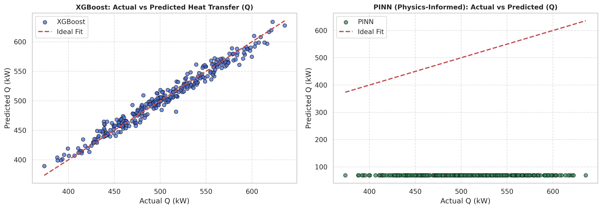
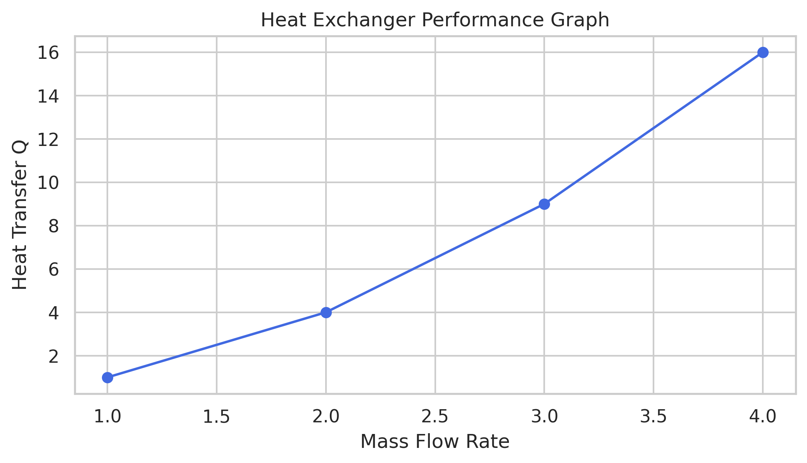
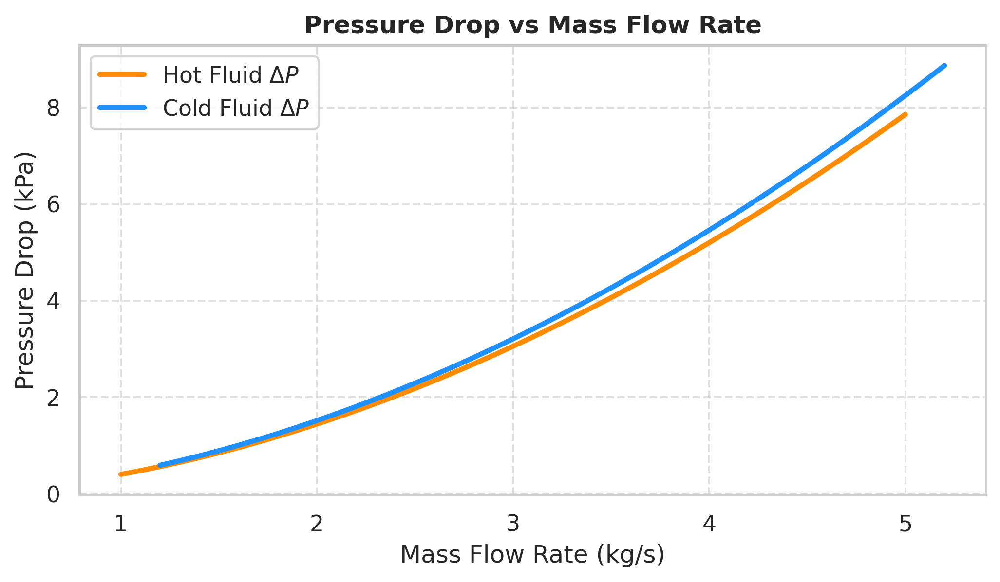

# 🚀 AI-Based Heat Exchanger Digital Twin (ANN, XGBoost, PINN)

An industry-grade engineering project bridging the gap between **Thermal Engineering** and **Artificial Intelligence** to build a robust Digital Twin for heat exchangers using Machine Learning and Deep Learning.

## 📌 Project Overview
This project simulates thermodynamic parameters (such as overall heat transfer coefficient $U$, outlet temperatures, and heat transfer rate $Q$) and compares traditional machine learning with physics-constrained deep learning models.

## 🛠️ Key Features & Modules
- **Thermal Calculations:** LMTD, Energy Balance, and Pressure Drop ($\Delta P$) estimation.
- **Machine Learning Baseline:** Trained and evaluated using **XGBoost Regressor** for high-speed tabular predictions.
- **Deep Learning (ANN):** Multi-layer Artificial Neural Network implemented in PyTorch.
- **Physics-Informed Neural Network (PINN):** Incorporates thermodynamic conservation laws ($Q = \dot{m} C_p \Delta T$) directly into the custom loss function to ensure physical validity.

## 🧰 Tech Stack
- **IDE:** Deepnote
- **Language:** Python
- **Libraries:** PyTorch, XGBoost, Scikit-Learn, Pandas, NumPy, Seaborn, Matplotlib

## 📊 Model Visualizations & Results

### 1. Model Performance: Actual vs Predicted Heat Transfer (Q)

### 2. Heat Exchanger Overall Performance

### 3. Pressure Drop vs Mass Flow Rate Analysis

## 🔗 How to Run
You can explore the complete interactive code and training steps directly in the uploaded `Notebook 1.ipynb` file.
